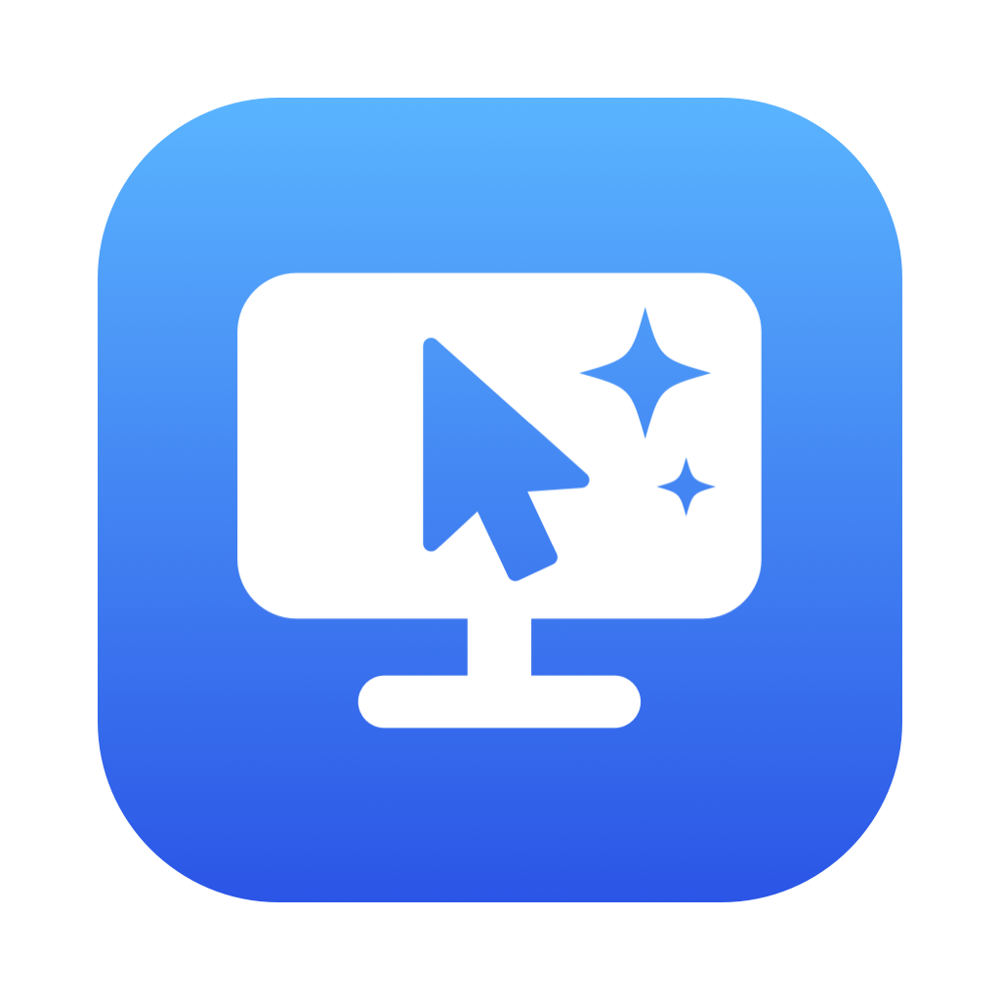

# 휘리릭 (Whirrik) — 내 맥을 아이폰·아이패드에서

내 맥을 **아이폰·아이패드·다른 맥**에서 원격으로 쓰는 앱이에요.
한글 입력이 맥 앞에서 치는 것처럼 자연스럽고, 집 밖에서도 Apple 로그인만 하면 바로 연결돼요.

## 설치

1. **맥** — [휘리릭 맥 앱 내려받기](https://github.com/hanseolhui/whirrik/releases/latest/download/Whirrik.zip) (macOS 14 이상, 애플 공증 완료)
   압축을 풀고 `Whirrik.app`을 응용 프로그램 폴더로 옮긴 뒤 열어요.
2. 맥에서 **Apple로 로그인**하고, **화면 기록·손쉬운 사용** 권한을 허용해요.
3. **아이폰·아이패드** — [App Store에서 「휘리릭: 맥 원격 데스크톱」](https://apps.apple.com/app/id6821134246)을 받아 같은 Apple ID로 로그인하면 내 맥이 나타나요.

## 특징

- **한글 입력** — 물리 키보드는 맥의 두벌식이 그대로 조합, 화상 키보드도 깨지지 않게
- **어디서든** — 같은 와이파이는 직접, 집 밖은 IPv6 직접 → P2P → 중계 순으로 자동
- **종단 암호화** — 화면·소리·입력·클립보드는 기기끼리만 풀 수 있어요
- 핀치 줌, 터치/트랙패드 모드, 커서 잠금(아이패드), 모니터 여러 대 전환, 맥 소리 듣기, 클립보드 공유
- 느린 망에서는 화질을 자동으로 낮춰 반응 속도를 지켜요

## 도움말

- [지원](https://whirrik-relay.hanseolhui.workers.dev/support) · [개인정보 처리방침](https://whirrik-relay.hanseolhui.workers.dev/privacy)
- 문의: imseolhui@gmail.com

© 2026 서리아트 (SeoriArts)
